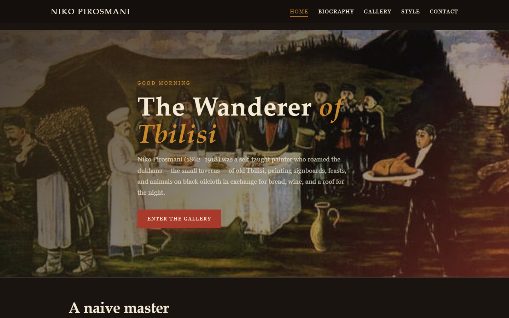
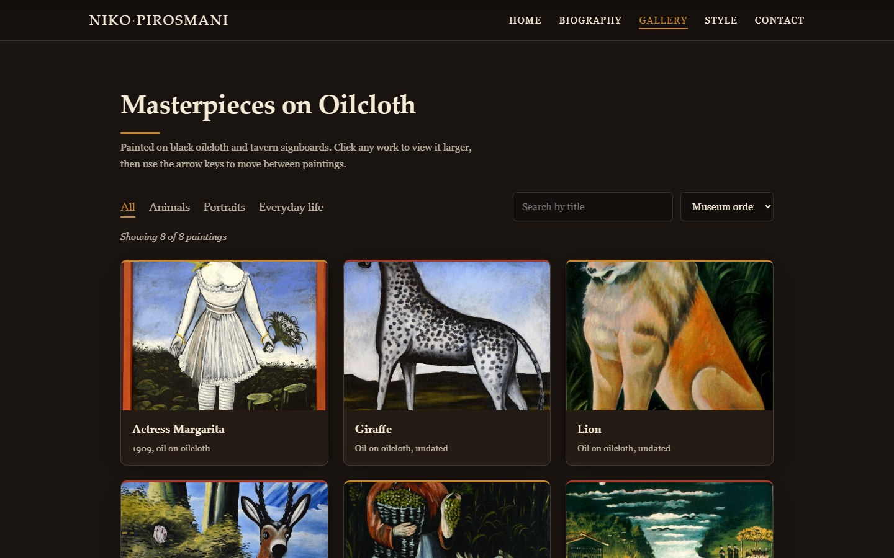
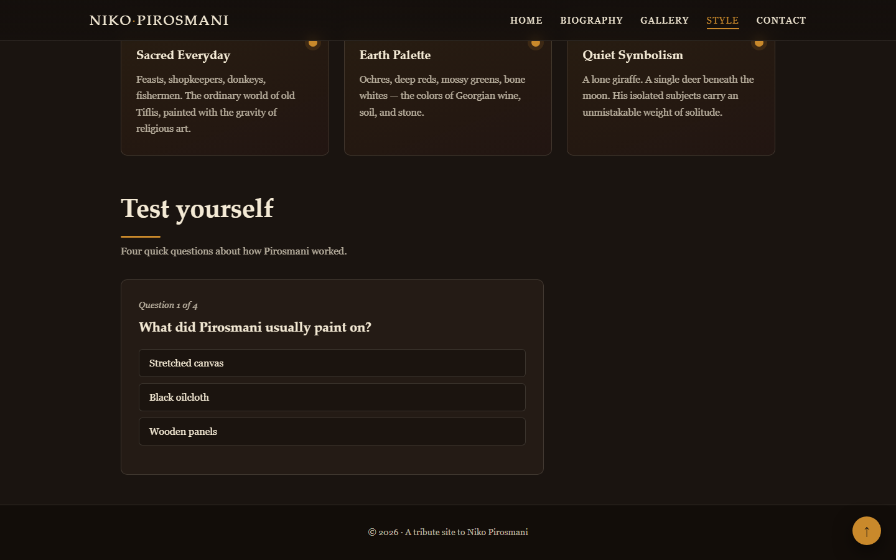

# PIROSMANI

A static tribute website to Niko Pirosmani, the self-taught Georgian painter known for his works on black oilcloth.

**Live site:** https://anipiro.github.io/PIROSMANI/



## What it does

- **Home page.** A hero section with a greeting that changes with the time of day, a short introduction, and a "painting of the day" picked from the gallery data by date.
- **Biography.** A short life story and a timeline.
- **Gallery.** Eight paintings loaded from a JSON file. You can filter by subject (animals, portraits, everyday life), search by title, and sort A–Z or Z–A.
- **Image viewer.** Clicking a painting opens it large with its caption. Previous and next buttons, the arrow keys and Escape all work.
- **Style page with a quiz.** Six cards describe Pirosmani's technique, followed by a four-question quiz that marks each answer, shows the score and lets you try again.
- **Contact form.** Each field is checked on blur and while typing, and the message has a character counter. The form is a front-end demo: it shows a success message but does not send anything.





## How it is built

| Part | Technology |
| --- | --- |
| Pages | HTML5, one file per page |
| Styling | CSS3, a single stylesheet (`css/style.css`) |
| Behaviour | Vanilla JavaScript, ES modules |
| Data | `data/paintings.json`, loaded with `fetch` |
| Formatting | Prettier (`.prettierrc`) |
| Hosting | GitHub Pages |

There is no build step and no runtime dependency. The five pages (`index.html`, `bio.html`, `gallery.html`, `style.html`, `contact.html`) all load `js/main.js`, which imports the other modules and starts each one when the page is ready.

| File | What it does |
| --- | --- |
| `js/nav.js` | Mobile menu toggle, active link, back-to-top button |
| `js/painting.js` | `Painting` class and loading the JSON data |
| `js/gallery.js` | Cards, filters, search and sorting |
| `js/modal.js` | The large image viewer |
| `js/home.js` | Greeting and painting of the day |
| `js/form.js` | Contact form checks |
| `js/quiz.js` | `Quiz` class with private fields |

## Run it locally

The scripts use ES modules and `fetch`, so the pages must be served over HTTP. Opening `index.html` straight from the file system will not load them.

```sh
git clone https://github.com/anipiro/PIROSMANI.git
cd PIROSMANI
npx serve .
```

Any static server works, for example `python -m http.server 8000` or the Live Server extension in VS Code. Then open the address the server prints.

To format the JavaScript with Prettier:

```sh
npm install --save-dev prettier
npm run format
```

## Credits

- Subject: Niko Pirosmani (1862–1918).
- Images: public domain, from Wikimedia Commons, as noted in the gallery footer.
